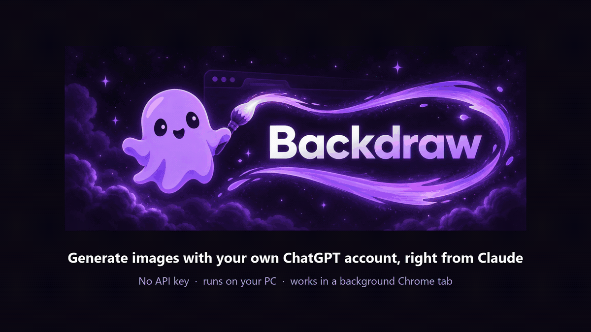

<p align="center">
  
</p>

<p align="center">
  <b>Let Claude generate images with your own ChatGPT account, in a background Chrome tab.<br>No API key, no extra cost, nothing to watch.</b>
</p>

<p align="center">
  <a href="https://www.npmjs.com/package/backdraw"></a>
  <a href="https://glama.ai/mcp/servers/devtalh/backdraw"></a>
</p>

<p align="center">
  
</p>

<p align="center"><a href="README.tr.md">Türkçe</a></p>

---

## What it does

Backdraw is a local MCP server plus a Chrome extension. Ask Claude for an image "with ChatGPT" and
Backdraw opens ChatGPT in a background tab of your own Chrome, where you are already signed in. It
sends the prompt, waits for the picture and saves it on your PC. Claude gets the file path, a preview
and the link to the chat.

- Generate new images, or edit one by attaching it as a reference.
- Ask for a shape (`16:9`, a `4:1` banner, …) or a transparent background.
- Save reference images from any website with a right-click and reuse them as collections.
- Browse everything you made in a gallery side panel.
- Pure Node.js with zero npm dependencies. Everything runs on your computer.

> **Personal use, with your own ChatGPT account and at your own risk.** Automating the ChatGPT web
> page may conflict with OpenAI's terms; read
> [Disclaimer and responsible use](#disclaimer-and-responsible-use) before you start.

## Why Backdraw?

- **Your everyday Chrome.** No separate browser profile, no second login, no automation browser:
  Backdraw works in the Chrome you already use, where you are signed in to ChatGPT.
- **Out of your way.** The work happens in a muted background tab that never takes focus, so you
  keep working while the image is made.
- **No open ports.** The pieces talk over Chrome native messaging and a named pipe that only your
  Windows user can open. There is no DevTools port (such as 9222) and no local web server.
- **No API key.** It uses your ChatGPT plan; each image counts toward your normal ChatGPT limits.
- **References from the web.** Right-click images on any site to collect them, then generate in
  their style.
- **A gallery** of everything you made, in Chrome's side panel.
- **One command to set up:** `npx backdraw@latest setup`. Loading the extension is the only step
  left to you.

### How it compares

Other open-source projects take different approaches, and several of them do things Backdraw
doesn't (macOS or Linux support, an API mode, running on a server). Each row was checked against
the project's README and source on 2026-10-25; **?** means we couldn't tell. Spotted a mistake?
Please [open an issue](../../issues).

| Project | Uses your everyday Chrome (no separate profile or login) | Background tab (doesn't take focus) | Open port | API key needed | Right-click reference collections | Gallery | Platforms |
|---|---|---|---|---|---|---|---|
| **Backdraw** | Yes | Yes | No (native messaging + named pipe) | No | Yes | Yes | Windows |
| [lownamlee/gpt-image-2-mcp](https://github.com/lownamlee/gpt-image-2-mcp) | No (own browser profile) | Partly¹ | No | Optional (API mode) | No | No | ? |
| [nothariharan/image-gen](https://github.com/nothariharan/image-gen) | No (own Edge profile) | No | Yes (CDP 9222) | No | No | No | Windows; macOS/Linux by hand |
| [goofyshwetank/mcp-chatgpt-gemini-image](https://github.com/goofyshwetank/mcp-chatgpt-gemini-image) | No (own Chromium profile) | No | No | No | No | No | ? |
| [Dasemu/chatgpt-imagegen-mcp](https://github.com/Dasemu/chatgpt-imagegen-mcp) | No (own profile, on a server) | Partly² | Yes (HTTP 8088, remote server) | No (own server token) | No | No | Linux server |
| [Codex built-in `$imagegen`](https://learn.chatgpt.com/codex/image-generation) | – (no browser) | – | No | No (Codex sign-in) | No | ? | ? |
| [Sateezg/codex-bridge](https://github.com/Sateezg/codex-bridge) | – (no browser, runs Codex) | – | No | No (Codex sign-in) | No | No | macOS, Linux |

¹ Its own browser window, moved off screen or minimized once ChatGPT is ready.
² A browser on a virtual display (Xvfb) on the server, or headless.

Codex users already have built-in image generation; Backdraw is mainly for Claude Code, the
Claude desktop app and VS Code.

## How it works

```
Claude Code / Claude desktop app (MCP client)
        │  MCP over stdio
        ▼
  mcp-server.js ──── named pipe, your Windows user only ────►  host.js
                                                                 │  Chrome native messaging
                                                                 ▼
                                                     Backdraw Chrome extension
                                                                 │  background tab
                                                                 ▼
                                      chatgpt.com → your Project → new chat → image
```

- `mcp-server.js` is what Claude talks to. It forwards every tool call to `host.js`.
- `host.js` is started by Chrome when the extension connects. It runs the job queue (one job at a
  time), saves the images and keeps the job history in `%USERPROFILE%\.backdraw\data`.
- The extension opens chatgpt.com in a **background tab**, inside the ChatGPT Project you selected.
  The tab is never activated and is muted, no window takes focus, and your mouse and keyboard are
  never used: only synthetic events inside that one tab. The tab closes when the job is done, unless
  you are looking at it.
- **No API key.** Backdraw uses the ChatGPT session you already have in Chrome. It never reads
  cookies, tokens or passwords.
- **Nothing leaves your PC except what you send to ChatGPT** (the prompt and any reference images).
  There is no Backdraw server and no telemetry.

Images are saved in your Pictures folder under `Backdraw`, named after the time and the prompt, e.g.
`20261021-153012_a-cozy-reading-nook.png`.

## Requirements

| | |
|---|---|
| OS | Windows 10 or 11 |
| Browser | Google Chrome 116 or newer (Edge, Brave and Chromium are registered too, but only Chrome is tested) |
| Runtime | Node.js 20 or newer |
| Account | A ChatGPT account that can generate images, signed in to chatgpt.com in Chrome |
| Client | Claude Code, the Claude desktop app, Codex, Cursor, VS Code or Gemini CLI (or another MCP client that runs stdio servers) |

Windows only for now — the code is split into a platform module and macOS/Linux contributions are
welcome. Everything OS-specific (named pipe, native host registration, user folders) lives in
`platform/win32.js`.

## Installation

### Quick install

Run this in PowerShell or cmd (no admin rights needed):

```
npx backdraw@latest setup
```

It runs the [`backdraw` package from npm](https://www.npmjs.com/package/backdraw).

`setup` does everything except one click in the browser:

1. It copies Backdraw to `%USERPROFILE%\.backdraw` (npx's own copy is temporary) and sets up the
   images folder `Pictures\Backdraw` (reference collections go to `Pictures\Backdraw\References`).
   Running it again updates Backdraw and keeps your settings, job history and collections.
2. It registers the native messaging host for your Windows user, for each browser it finds
   (Chrome, Edge, Brave, Chromium).
3. It lists the MCP clients it finds (Claude Code, the Claude desktop app, Codex, Cursor, VS Code,
   Gemini CLI) and asks which ones to add Backdraw to. Only the `backdraw` entry is added or
   updated, and every config file gets a timestamped `.bak` copy before it changes.
   `--yes` takes every client it found; `--clients=claude-code,cursor` takes exactly those.
4. It opens the extension folder and your browser's extensions page, copies the folder path to the
   clipboard, and waits for you to **load the extension**, the one step left to you:
   1. turn on **Developer mode** (top right),
   2. click **Load unpacked**,
   3. pick the folder (paste the path with Ctrl+V).

   As soon as the extension connects, setup prints **✓ Ready** and an example prompt.

The native host is still named `io.github.muhammedtalha04.backdraw`, after the project's old GitHub
user name: renaming it would break existing installs.

### Install from your client

Your MCP client can also add Backdraw itself; it then starts the server with
`npx backdraw@latest mcp`. The browser side still needs a one-time setup on the PC, which leaves the
clients alone:

```
npx backdraw@latest setup --clients=none
```

| Client | Add Backdraw |
|---|---|
| Claude Code | `/plugin install backdraw --marketplace devtalh/backdraw` (Claude Code 2.1.275 or later; or `/plugin marketplace add devtalh/backdraw`, then `/plugin install backdraw@backdraw`). `/backdraw:setup` explains the browser step. |
| Cursor | [](https://cursor.com/install-mcp?name=backdraw&config=eyJjb21tYW5kIjoiY21kIiwiYXJncyI6WyIvYyIsIm5weCIsIi15IiwiYmFja2RyYXdAbGF0ZXN0IiwibWNwIl19) |
| VS Code | [](https://insiders.vscode.dev/redirect/mcp/install?name=backdraw&config=%7B%22type%22%3A%22stdio%22%2C%22command%22%3A%22cmd%22%2C%22args%22%3A%5B%22%2Fc%22%2C%22npx%22%2C%22-y%22%2C%22backdraw%40latest%22%2C%22mcp%22%5D%7D) |
| Codex | `codex mcp add backdraw -- cmd /c npx -y backdraw@latest mcp` |
| Gemini CLI | `npx backdraw@latest setup --clients=gemini` |

On Windows the command goes through `cmd /c`, because clients start `npx` without a shell. Use one
way per client: if setup already added Backdraw to Claude Code, the plugin would start a second
server with the same tools.

### Manual install

1. **Get the code.** Clone the repository with git, or download it as a ZIP (**Code** →
   **Download ZIP**) and unzip it:

   ```
   git clone https://github.com/devtalh/backdraw.git
   cd backdraw
   ```
2. **Run the installer** in that folder (no admin rights needed):

   ```
   node install.js
   ```

   It does steps 1 and 2 above and adds Backdraw to Claude Code (user scope). For the other
   clients, run `node bin/backdraw.js setup` instead, or see [Use it](#use-it).
3. **Load the extension** once: open `chrome://extensions`, turn on **Developer mode**, click
   **Load unpacked** and select `%USERPROFILE%\.backdraw\extension`.

### Finish in the popup

1. **Open the popup.** Click the Backdraw icon in the toolbar (pin it from the puzzle-piece menu).
   Until everything works, the popup shows a setup checklist with the fix for each step:
   1. the bridge is connected,
   2. you are signed in to ChatGPT,
   3. a ChatGPT Project is selected,
   4. ready: an example prompt to copy into Claude.
2. **Create and select a ChatGPT Project.** In ChatGPT, create a Project for your images (for
   example "Backdraw"), open it, click the Backdraw icon and press **Use the “Backdraw” project**.
   You can also ask Claude: *"Select my Backdraw project in ChatGPT for images."* Every new image
   chat is created inside that Project.

The popup also has a language (Auto / English / Türkçe) and a theme (Auto / Light / Dark) setting.
If something doesn't work, run [`npx backdraw@latest doctor`](#doctor).

## Use it

### From Claude Code

Start a **new** Claude Code session after installing (MCP servers are loaded when a session
starts) and ask in plain words, in any language. The `backdraw` server gives Claude these tools:
`generate_image`, `job_status`, `cancel_job`, `fetch_images`, `list_projects`, `select_project` and
`list_collections` (see [Tools reference](#tools-reference)).

### From the Claude desktop app (chat)

The desktop app keeps its own MCP config for chats. Claude rewrites that config when it exits, so
Backdraw only changes it while Claude is closed. If setup found Claude running, add Backdraw later:

1. Quit Claude **completely**, also from the system tray.
2. Run this from **PowerShell** (not from a Claude session):

   ```powershell
   npx backdraw@latest setup --clients=claude-desktop
   ```

   (From a manual install: `node install.js --desktop` in `~\.backdraw`.) A timestamped `.bak` copy
   of each config file is written before it is changed.
3. Start Claude again. Backdraw is available in new chats.

### From other MCP clients

`setup` adds Backdraw to Codex, Cursor, VS Code and Gemini CLI too: pick them when it asks, or run
`npx backdraw@latest setup --clients=codex,cursor,vscode,gemini`. It writes the full path of
`node.exe` as the command, so a client that doesn't see your `PATH` still finds it. Restart the
client or start a new session afterwards.

VS Code and Gemini CLI allow comments in their config files. Rewriting such a file would drop the
comments, so setup leaves a file with comments alone and tells you; add the entry by hand then.

Backdraw is a plain stdio MCP server: `node %USERPROFILE%\.backdraw\mcp-server.js`. To add it by
hand, use the examples below. In the config files, replace `C:/Users/you` with your home folder
(`echo %USERPROFILE%` in cmd prints it). Forward slashes work on Windows and need no escaping in
JSON. `~` below is your home folder. The PowerShell commands fill in the path themselves.

**Codex** (the CLI, the IDE extension and the app share `~\.codex\config.toml`;
[docs](https://learn.chatgpt.com/docs/extend/mcp)). From PowerShell:

```powershell
codex mcp add backdraw -- node "$env:USERPROFILE\.backdraw\mcp-server.js"
```

or in `config.toml`:

```toml
[mcp_servers.backdraw]
command = "node"
args = ["C:/Users/you/.backdraw/mcp-server.js"]
```

**Cursor** (`~\.cursor\mcp.json` for all projects, or `.cursor\mcp.json` in a project;
[docs](https://cursor.com/docs/context/mcp)). Cursor fills in `${userHome}` itself:

```json
{
  "mcpServers": {
    "backdraw": {
      "type": "stdio",
      "command": "node",
      "args": ["${userHome}/.backdraw/mcp-server.js"]
    }
  }
}
```

**VS Code** (GitHub Copilot agent mode: run **MCP: Open User Configuration** for every workspace,
or create `.vscode\mcp.json` in one; [docs](https://code.visualstudio.com/docs/copilot/customization/mcp-servers)).
Here the key is `servers` and `type` is required:

```json
{
  "servers": {
    "backdraw": {
      "type": "stdio",
      "command": "node",
      "args": ["C:/Users/you/.backdraw/mcp-server.js"]
    }
  }
}
```

**Gemini CLI** (`~\.gemini\settings.json`;
[docs](https://github.com/google-gemini/gemini-cli/blob/main/docs/tools/mcp-server.md)). `-s user`
adds it for all projects (the default is the current project only). From PowerShell:

```powershell
gemini mcp add -s user backdraw node "$env:USERPROFILE\.backdraw\mcp-server.js"
```

or in `settings.json`:

```json
{
  "mcpServers": {
    "backdraw": {
      "command": "node",
      "args": ["C:/Users/you/.backdraw/mcp-server.js"]
    }
  }
}
```

## Example prompts

| You say | What Claude passes to `generate_image` |
|---|---|
| *Generate an image with ChatGPT: a cozy reading nook by a rainy window, warm lamp light.* | a detailed `prompt` |
| *Make a 16:9 banner for my blog with ChatGPT: "Night Shift Notes", neon city at dusk.* | `aspect_ratio: "16:9"` |
| *Use ChatGPT to make a sticker of a happy cactus with a transparent background.* | `transparent_background: true` |
| *Edit `C:\path\to\photo.png` with ChatGPT: turn the sky into a sunset, keep everything else.* | `reference_images: ["C:\\path\\to\\photo.png"]` |
| *Use my "Cats" collection as reference and make a poster with ChatGPT.* | `reference_collection: "Cats"` |

To edit an image, Backdraw needs it as a file on your PC: give Claude its full path (type or paste
it) so Claude can pass it in `reference_images`. Files saved by earlier calls work directly. A fresh
chat with the image attached is the most reliable way to edit.

You can also ask *"What's the status of the ChatGPT image job?"* or *"Cancel it."*

## Reference collections

Collect images from the web, then use them as references.

1. Right-click an image on any web page → **Add to Backdraw** → pick a collection, or
   **New collection…** (a small window asks for the name).
2. A short note in the page confirms it, e.g. "Added to Cats · 5 images". On pages where Chrome
   doesn't let extensions show anything, the toolbar icon flashes a ✓ (or a red ! on error) instead.
3. Ask Claude to use the collection by name.

Each collection is a folder `Pictures\Backdraw\References\<collection>\` with the images (named by
Backdraw: `001_<name>.png`, …), a `collection.json` with the source page and date of each image,
and a `thumbs\` folder. Adding the same image to a collection twice keeps one copy. PNG, JPEG, WebP
and GIF are kept as they are; other formats Chrome can show (such as AVIF, BMP or SVG) are saved as
PNG. If you delete an image file by hand, it drops out of the collection.

The popup's **Collections** section lists your collections. Open one to see its thumbnails, delete
images, or rename or delete the collection.

| Limit | |
|---|---|
| References per message | 16 (`reference_images` and collection images together; ChatGPT accepted 16 in testing) |
| One reference | 20 MB |
| All references of one message | 80 MB |
| One collection image | 25 MB (an image over 20 MB stays in the collection; requests leave it out and say so, and naming it in `reference_files` makes the request fail with a message) |

A request uses the **newest** images of the collection that fit in the free slots. To use specific
ones, name them: Claude passes their file names (from `list_collections`) in `reference_files`.

## Sizes and transparency

### `aspect_ratio`

`W:H` with whole numbers, anywhere from `1:4` to `4:1`: `1:1`, `3:2`, `2:3`, `4:5`, `16:9`, `9:16`,
`5:2` (Discord banner), `3:1`, `4:1`, … `1920:1080` is reduced to `16:9`; write `3:2`, not `1.5:1`.
A few names work too: `square`, `landscape` (3:2), `portrait` (2:3), `wide` (16:9), `tall` (9:16),
`discord-banner` (5:2).

- **1:3 to 3:1:** ChatGPT draws these itself, at about 1.57 megapixels in the asked shape. Observed
  in October 2026: 1254×1254 (1:1), 1536×1024 (3:2), 1672×941 (16:9), 1983×793 (5:2).
- **Up to 4:1 / 1:4:** ChatGPT is asked for 3:1 (or 1:3) and told to keep subjects, faces and text
  inside the band that survives the crop; Backdraw then crops it from the centre.
- An image more than 1% off the asked ratio is cropped from the centre. The crop is the main file
  (`<name>.png`) and ChatGPT's original stays next to it as `<name>_full.<ext>`. `output_dir`
  copies get the main file only.
- If ChatGPT drew another shape and the crop had to cut more than planned, the result warns you to
  check for cut-off subjects or text.

### `transparent_background`

`transparent_background: true` asks ChatGPT for a PNG with an alpha channel that shows only the
subject. ChatGPT doesn't always deliver, so Backdraw checks the saved image: it reads the PNG header
(alpha channel or `tRNS` chunk) and measures the share of see-through pixels. The result says
either

```
Transparent background: yes — PNG with an alpha channel, 61% of the pixels are transparent.
```

or starts with `⚠ TRANSPARENT BACKGROUND MISSING` (no alpha channel, or 2% or fewer of the pixels are transparent). Then
retry once in a fresh chat or remove the background with another tool. Previews of transparent
images are drawn over a checkerboard.

## Gallery side panel

Click **Open gallery** in the popup to open Backdraw's side panel next to the page you are on. You
can also right-click the Backdraw toolbar icon → **Open Backdraw gallery**.

- **Top:** the job in progress (step, job id and elapsed time; hover for ChatGPT's message), "Idle",
  or a not-connected notice.
- **Gallery:** your generated images, newest first, 12 at a time (**Load more**), each with a
  thumbnail, the date, the prompt (hover to see its first 300 characters), the size and, if one was
  asked, the aspect ratio.
- **Per image:** **Open chat**, **Show in folder** (Explorer with the file selected),
  **Copy path** and **Add to collection** (an existing collection or **New collection…**).

The gallery lists the images of the job history, which keeps the last 100 jobs. Thumbnails come
from the previews, which are kept for 7 days; older images show a placeholder. The image files
themselves stay in your images folder.

## Tools reference

| Tool | Parameters (default) | What it does |
|---|---|---|
| `generate_image` | `prompt` (required), `aspect_ratio`, `transparent_background` (false), `reference_images`, `reference_collection`, `reference_files`, `conversation_url`, `auto_reattach` (false), `send_as_is` (false), `output_dir`, `filename_hint`, `wait_seconds` (45), `include_preview` (true) | Starts a new chat in your Project (or continues `conversation_url`) and generates or edits an image. |
| `job_status` | `job_id`, `wait_seconds` (45), `include_preview` (true) | Waits for a job and reports it. Without `job_id`: the bridge status (Chrome connected, selected Project, images folder, queue, recent jobs). |
| `cancel_job` | `job_id` (required) | Cancels a queued or running job. If ChatGPT is already generating, it presses Stop in the background tab. |
| `fetch_images` | `conversation_url` (required), `aspect_ratio`, `output_dir`, `wait_seconds` (45), `include_preview` (true) | Downloads the images of the latest answer in an existing chat, without sending anything. |
| `list_projects` | – | Lists your ChatGPT Projects and shows the selected one. |
| `select_project` | `name` or `url` | Selects and remembers the Project for new image chats (the name is matched loosely). |
| `list_collections` | – | Lists your reference collections with image counts, folders and files (newest first). |

- `reference_images`: local png / jpg / webp / gif files, up to 16; collection images fill the
  slots that are left.
- `reference_files`: file names from `list_collections`, to attach only those images of `reference_collection`.
- `conversation_url`: a `https://chatgpt.com/` chat link. Fine for quick follow-ups; for exact
  edits a fresh chat with `reference_images` works better.
- `auto_reattach`: if ChatGPT says it can't see the image and asks for it again, attach it
  automatically and ask once more.
- `send_as_is`: send the prompt word for word, without the short instruction Backdraw adds (e.g. to
  answer a question ChatGPT asked).
- `output_dir`: also copy the result into this folder; the images folder always keeps a copy.
- `filename_hint`: a few words naming the subject, used for the file name instead of the start of
  the prompt (handy when the prompt opens with instructions about the reference images).
- `wait_seconds`: 0 to 900.

What a result can say:

| Result | Meaning |
|---|---|
| `SUCCESS` | Saved file path(s), the chat link and a preview. Edits add an **edit check** line. |
| `STILL RUNNING` / `QUEUED` | Not done yet; Claude keeps calling `job_status` with the job id. |
| `NEEDS USER ACTION` | ChatGPT shows a login or human-verification page (see [Troubleshooting](#troubleshooting)). |
| `NEEDS REFERENCE IMAGE` | ChatGPT couldn't reach the image it should edit. The result lists images already saved from that chat. |
| `CHATGPT REPLIED WITHOUT AN IMAGE` | ChatGPT answered in text (a question, a refusal, a limit); up to 3,000 characters of it are included. |
| `FAILED` / `CANCELLED` | With the reason, and the chat link if there is one. |

## Fast return

Generating usually takes 1-3 minutes, but `generate_image`, `fetch_images` and `job_status` return
within **45 seconds** by default (`wait_seconds`). If the image isn't ready yet, the result is
`STILL RUNNING` or `QUEUED` (with the queue position) plus a job id, and Claude calls
`job_status(job_id, wait_seconds=45)` again until the job is done.

Clients that reach your PC from the cloud often give up on a tool call after 60 seconds; the
45-second default keeps these calls under that limit. When the client asks for progress, Backdraw
sends progress notifications while it waits. Cancelling a tool call in the client only stops the
waiting; the job keeps running until `cancel_job` stops it.

## CLI

For setup and troubleshooting, run these in the Backdraw folder (`%USERPROFILE%\.backdraw`, or the
folder you installed from). From anywhere, `npx backdraw <command>` runs the same commands, e.g.
`npx backdraw status`. `npm run status` is the same as `node cli.js status`. `backdraw mcp` runs
the MCP server itself on stdio; that is what MCP clients start.

```
node cli.js status                          Bridge status (Chrome connected, selected project, queue)
node cli.js projects                        List ChatGPT projects
node cli.js select <name | link>            Select the project where images are generated
node cli.js generate "<prompt>" [--ref IMAGE]... [--url CHAT_LINK] [--aspect W:H] [--transparent]
                     [--reattach] [--out FOLDER] [--raw] [--wait 300] [--collection NAME [--file FILE]...]
                                            Generate an image (--ref: a reference or the image to edit, up to 16)
node cli.js collect <chat link> [--aspect W:H] [--out FOLDER]
                                            Download the latest images of an existing chat (sends nothing)
node cli.js job <id> [--wait 60]            Show a job's status
node cli.js cancel <id>                     Cancel a job
node cli.js collections                     List the reference collections
node cli.js collection <name>               Show one collection and its images
node cli.js outdir <folder>                 Change the central images folder
node cli.js debug on|off                    Verbose logging (logs\host.log)
node cli.js diagnose [link] [--selector CSS] [--max N] [--worker]
                                            Page diagnostics
node cli.js reload                          Reload the Chrome extension
```

Examples:

```
node cli.js generate "a lighthouse at dawn, watercolor" --aspect 16:9
node cli.js generate "close only the eyes" --ref C:\path\to\portrait.png
node cli.js collect https://chatgpt.com/c/<chat id> --aspect 16:9
```

## Doctor

```
npx backdraw@latest doctor          checks everything, changes nothing
npx backdraw@latest doctor --fix    repairs what is safe to repair, then checks again
```

`doctor` prints one line per check, ✓ (fine), ⚠ (worth a look) or ✗ (broken), each with a one-line
fix:

- Node.js version, the install folder, and that its files, the extension and this version match.
- The host manifest and, for each installed browser, the registry entry it really reads (also
  from inside the Claude desktop app's MSIX sandbox).
- Browser policies that switch off per-user native hosts (`NativeMessagingUserLevelHosts`) or block
  them (`NativeMessagingBlocklist`). Only an administrator can change these.
- The bridge (named pipe), the extension and its version, the ChatGPT sign-in as the extension
  last saw it, and whether a Project is selected.
- Every MCP client's Backdraw entry: there, and pointing to this install. It also says whether the
  Claude desktop app is running.

`--fix` rewrites the host manifest and the registry entries, and points client entries back at
this install (with a backup; the Claude desktop app only while it is closed). It says what it
couldn't fix. The output is safe to paste into an issue: your home folder is shown as `~`, and
project names, prompts and chat links are never printed.

## Troubleshooting

| Problem | What to do |
|---|---|
| Anything | Run `npx backdraw@latest doctor` first. |
| `BRIDGE NOT RUNNING` | Chrome is closed, or the extension is not loaded or turned off. Open Chrome (the extension connects by itself) or turn Backdraw on at `chrome://extensions`. Check with `node cli.js status`. |
| Red **!** on the Backdraw icon | The extension can't reach the local host. The popup shows the error and the fix. Run `npx backdraw@latest doctor --fix` (or `node install.js` again), then reload Backdraw at `chrome://extensions`. |
| `NEEDS USER ACTION` | ChatGPT shows a login or a human verification (CAPTCHA). Open the ChatGPT tab in Chrome and finish it yourself; Backdraw never tries to get around it. The job waits up to 10 minutes for you; as soon as you finish, it continues by itself. After 10 minutes it fails and leaves the ChatGPT tab open. |
| `⚠ EDIT CHECK (edited: false)` | ChatGPT drew a new picture instead of editing (a real edit keeps ~95-100% of the image). Ask again with the original in `reference_images` and without `conversation_url`, i.e. in a fresh chat. |
| `NEEDS REFERENCE IMAGE` | ChatGPT lost track of the image in a long chat. Attach it with `reference_images` (best in a fresh chat) or use `auto_reattach`. |
| `FAILED — ChatGPT did not finish in time` | A job gives up after about 10 minutes. If the result has a chat link, `fetch_images` (or `node cli.js collect <link>`) downloads the image once ChatGPT has finished; pass the same `aspect_ratio` again to crop it the same way. |
| `No ChatGPT project is selected yet` | Select one in the popup, or ask Claude to list and select your Projects. |
| `ChatGPT did not open the project` | The Project was deleted or renamed; select it again. |
| Two Chrome profiles | The local bridge is one per Windows user, so load Backdraw in one Chrome profile only. |

For a detailed log, run `node cli.js debug on` and look at `%USERPROFILE%\.backdraw\logs\host.log`
(turn it off again with `node cli.js debug off`).

### If the ChatGPT web UI changes

Backdraw drives the chatgpt.com web page, so a redesign can break it (for example, it can no longer
find the message box).

1. Run `node cli.js diagnose` (or `node cli.js diagnose <chat link>`). It prints a summary of the
   page structure Backdraw sees; `--selector CSS` and `--max N` narrow it down, `--worker` looks at
   the tab of the running job.
2. The selectors live in `extension/inpage.js`.
3. After a fix, run `node install.js` again: it copies the files and reloads the running extension.
4. Please [open an issue](../../issues) with what changed. Remove personal details (chat titles,
   project names, prompts) from the diagnose output first.

## Updating

```
npx backdraw@latest setup
```

From a manual install: `git pull` (or download the ZIP again), then `node install.js`.

Both copy the new files over the old ones, keep your settings, job history and collections,
register everything again and reload the running extension. If Chrome was closed, it loads the new
version when it starts.

**Coming from the "ChatGPT image bridge" (1.x)?** Setup (or `node install.js`) migrates it: it copies the
settings and job history from `%USERPROFILE%\.claude\chatgpt-image-bridge` (never overwriting) and
removes the old native host and the old `chatgpt-images` MCP entry. Then, at `chrome://extensions`,
remove the old "Claude ChatGPT Görsel Köprüsü" extension and load `%USERPROFILE%\.backdraw\extension`
instead; the extension ID stays the same. Delete the old folder by hand once Backdraw works.

## Uninstall

```
npx backdraw@latest uninstall --dry-run     shows what would be removed, changes nothing
npx backdraw@latest uninstall
```

(From a manual install: `node install.js --uninstall [--dry-run]`.) This removes the native host
registration of every browser, and the `backdraw` MCP entry from Claude Code, Codex, Cursor,
VS Code and Gemini CLI and, while Claude is closed, from the desktop app's config (each with a
backup), plus the names used by 1.x. Then remove the extension at `chrome://extensions`.

Your files are kept, in two places:

- `%USERPROFILE%\.backdraw`: the program, your settings, the job history (with prompts), previews
  and logs.
- The images folder, `Pictures\Backdraw` by default: your generated images and, under
  `References`, your reference collections. The dry run lists the folders actually used, and so
  does `node cli.js status` before you uninstall.

Delete these folders by hand if you want them gone. Coming from 1.x? Delete
`%USERPROFILE%\.claude\chatgpt-image-bridge` too.

## Privacy & security

- Everything runs on your PC: no Backdraw server, no telemetry, no API key.
- Backdraw never reads cookies, tokens or passwords, and never automates logins or CAPTCHAs: you complete them yourself.
- The local bridge is a named pipe, not a network port, and the native host only accepts the
  Backdraw extension.
- Prompts, job history, previews and logs stay in `%USERPROFILE%\.backdraw` (`data\` and `logs\`).
- `reference_images` can attach any local file whose name ends in `.png`, `.jpg`, `.jpeg`, `.webp` or
  `.gif` to a ChatGPT message. Review Backdraw's tool calls when Claude works with content you don't
  trust.

Details, the threat model and how to report a vulnerability: [SECURITY.md](SECURITY.md).

## MCP protocol support

- **2026-07-28** (stateless): no handshake; each request names its version in `_meta`;
  `server/discover` is supported.
- **Legacy `initialize` handshake:** 2025-11-25, 2025-06-18, 2025-03-26 and 2024-11-05.
- Tool titles and annotations, progress notifications, `notifications/cancelled` and JSON-RPC
  batches. An unsupported version gets error `-32022` with the list of supported ones.

## Disclaimer and responsible use

- **Personal use, your own account.** Backdraw is made for one person generating images with
  their own ChatGPT account in their own Chrome. Don't use it to share an account, to generate
  images for other people as a service, or as the backend of a product.
- **OpenAI's terms.** OpenAI's [Terms of Use](https://openai.com/policies/row-terms-of-use/) say
  you may not "automatically or programmatically extract data or Output", nor get around rate
  limits or protective measures. Backdraw drives the ChatGPT web page for you, so using it may
  conflict with these terms. Read them and decide for yourself.
- **The risk to your account is yours.** OpenAI may limit, suspend or close an account it finds
  in breach of its terms. Backdraw comes without any warranty ([MIT license](LICENSE)), and its
  authors are not responsible for what happens to your account.
- **One job at a time, at a human pace.** There is a single queue: one prompt in one background
  tab, and the next job starts only after the image is saved. Backdraw doesn't open parallel
  chats, doesn't resend prompts on its own (apart from the single re-ask of `auto_reattach`) and
  stops at every login or human-verification page until you finish it yourself.
- **Your normal limits apply.** Every image counts toward your own ChatGPT usage limits.
- Not affiliated with, endorsed or sponsored by OpenAI or Anthropic.

## License

[MIT](LICENSE)
